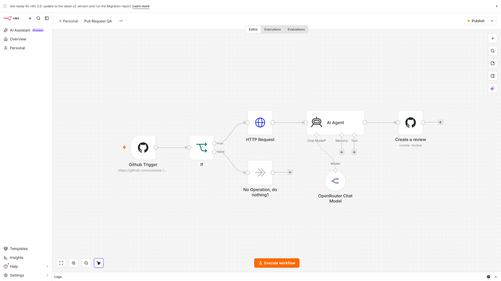
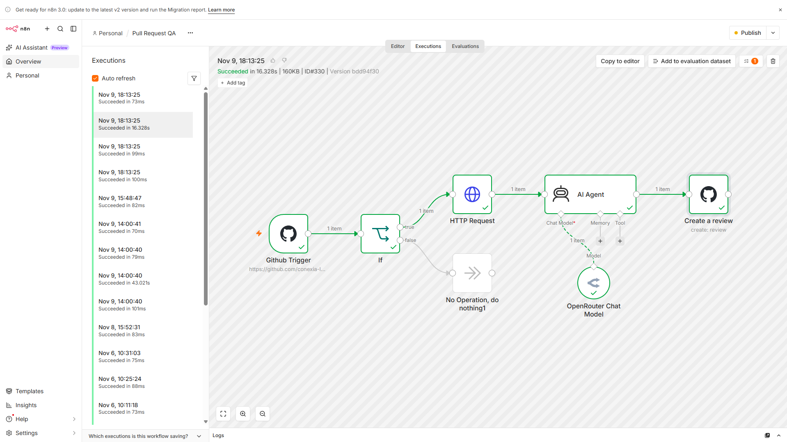
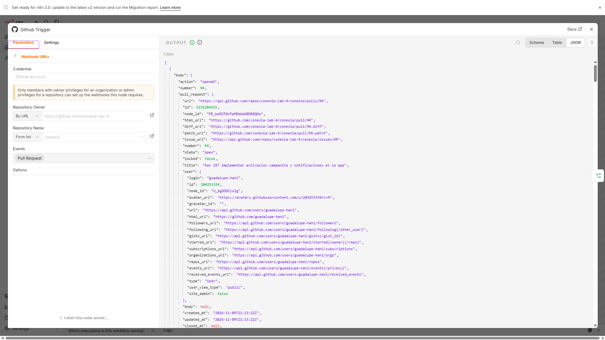
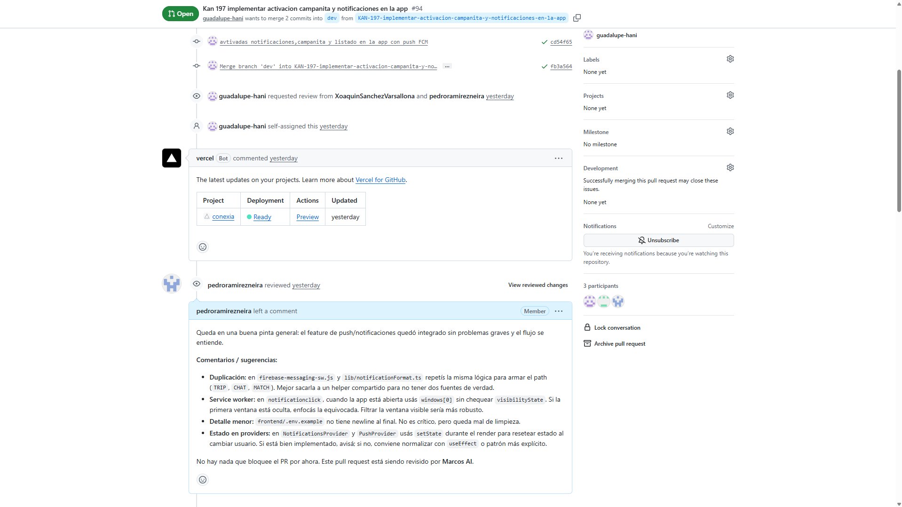

# Evidencia de uso — revisión automática de PR con n8n

Caso histórico aportado por el autor. Se incluyen las capturas originales, sin máscaras ni modificaciones, por indicación del autor.

## Configuración

Siete nodos: GitHub Trigger, If, HTTP Request, AI Agent, OpenRouter Chat Model, Create a review y rama No Operation. La captura muestra el flujo configurado; no acredita por sí sola una ejecución.

## Ejecución

La interfaz muestra ejecución #330 del 9 de noviembre a las 18:13:25, Succeeded en 16.328 s y versión bdd94f30. La zona horaria no figura en la imagen. Se conserva el resultado observado sin atribuirlo a una nueva ejecución.

## Entrada del caso

Se ve action opened y PR94 de conexia-lab-4/conexia, con enlace al diff. La captura fue aportada como entrada del mismo caso; no muestra simultáneamente la cabecera #330 y no se afirma una comprobación independiente en vivo de esa correlación. El payload se conserva como aparece en la captura original.

## Resultado publicado

La PR94 contiene feedback breve sobre duplicación, service worker y estado de providers. La captura original conserva los nombres, avatares y la firma histórica Marcos AI. La copia JSON usa Pedro AI por indicación del autor; las capturas no se modificaron para fingir que esa firma aparecía en la ejecución histórica.

## Límites y reutilización

El workflow revisa un diff, no todos los archivos completos, y no ejecuta tests ni verifica criterios de ticket. Publica una review comentario, no una aprobación o solicitud formal de cambios. No se afirma que todas las sugerencias sean correctas o adoptadas.

La copia compartida está desactivada y sin referencias de credenciales, webhook o instancia. Quien la importe debe configurar sus propias credenciales y revisar los dos nodos de GitHub antes de activarla. No se importó, activó ni ejecutó el flujo con esta preparación.
