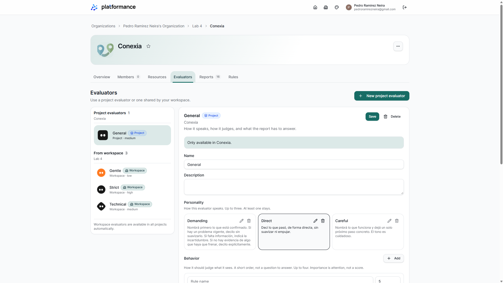
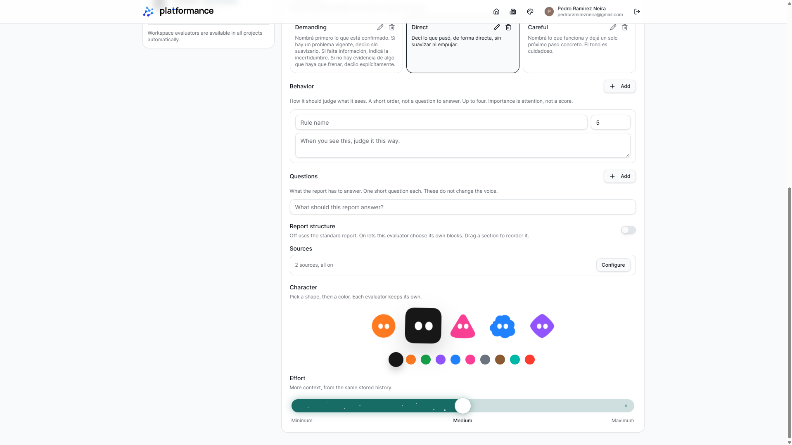
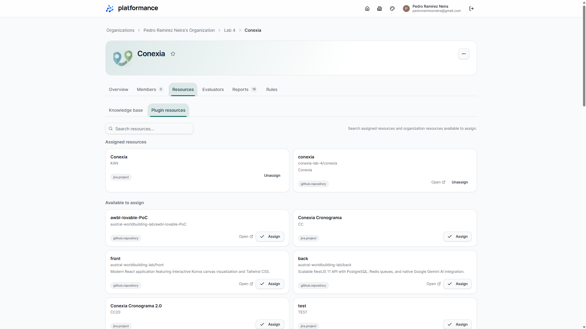
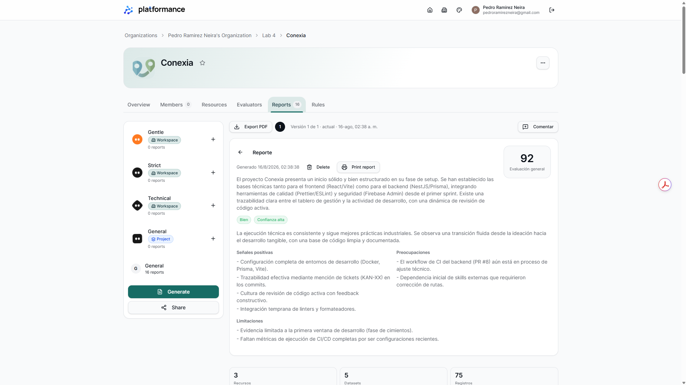
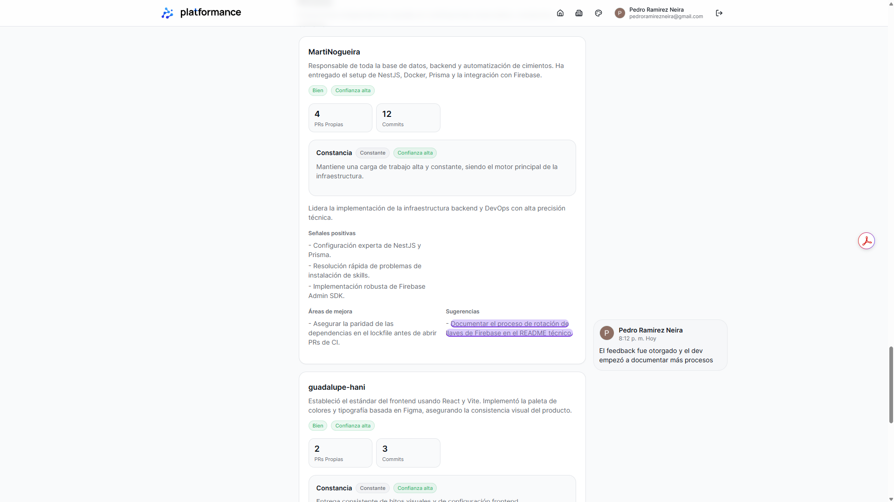

# Evidencia de uso — Platformance

Cinco capturas originales aportadas por el autor, sin máscaras ni modificaciones, incluidas por su indicación. Se omitió la captura individual sin comentario por redundancia.

## Configuración visible

Se ve General de proyecto, Direct, esfuerzo Medium, estructura estándar y dos fuentes habilitadas. No se atribuyen reglas personalizadas a campos con placeholders. La definición consultada el 10/11/2026 está en general-evaluator.json, INSTRUCTIONS.md y report.schema.json. Se eliminó únicamente el identificador de instancia de la configuración compartida.

## Fuentes asignadas

Assigned resources muestra Jira KAN y GitHub conexia-lab-4/conexia. Los recursos disponibles para asignar no se consideran fuentes activas del caso. No se afirma qué registros concretos o versiones históricas participaron en el reporte mostrado.

## Reporte histórico

La fecha visible de generación es 16/8/2026 02:38:38, que no determina el período de datos. La definición recuperada hoy no acredita ser la versión que generó ese reporte. Se describe la salida presentada por la aplicación; no se recalcula ni ratifica su puntuación.

## Seguimiento humano

La imagen conserva la sugerencia de documentar un proceso y el comentario humano que registra haber comunicado el feedback y observado más documentación. Se conserva el contexto visible de la captura original. La mejora posterior es una afirmación del comentario, no un diff verificado. No se atribuye regeneración automática del reporte.

## Alcance

Caso sustentado: recursos asignados → reporte y sugerencia → comentario humano de seguimiento. No se presenta como comprobación de todos los datos subyacentes ni del caso de cuello de botella en reviews relatado por el autor. No se generó ni guardó ningún reporte para esta entrega; la configuración y el esquema se recuperaron en modo lectura y se excluyó el historial del proyecto.
