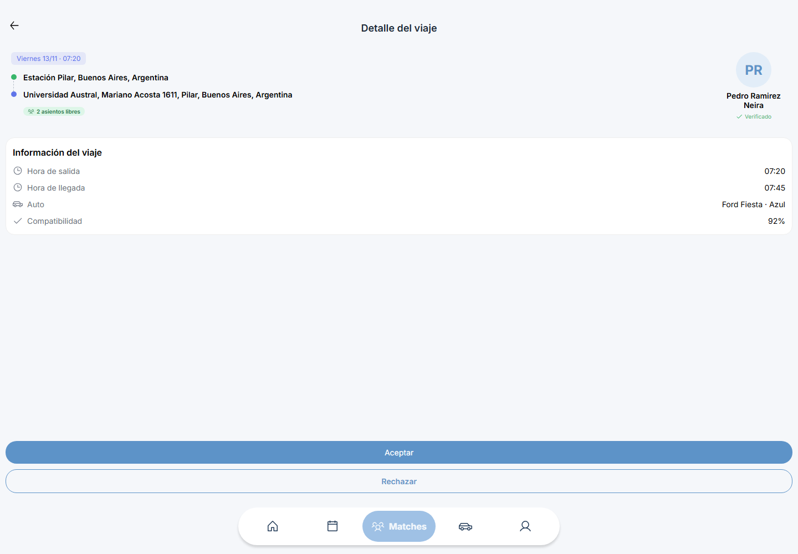
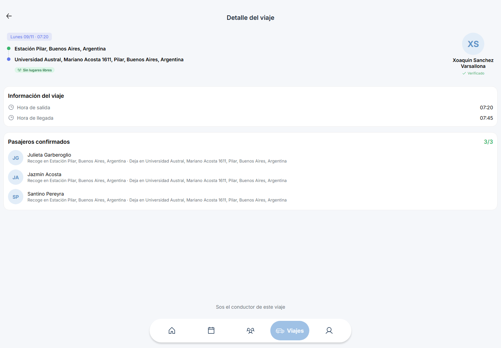

# Auditoría de Conexia para su demo

Resumen elaborado el 10/11/2026 a partir de la reauditoría del 5/11/2026 posterior al merge. Entorno observado: conexia.net.ar y su backend publicado. Cobertura del informe original: 17 recorridos autenticados en escritorio 1440 × 1000 y móvil emulado 390 × 844, con comprobaciones de acceso limpio y PWA.

## Qué pudo demostrarse

| Escenario | Resultado histórico |
|---|---|
| Login y navegación desde la portada | Las cinco cuentas de demo pudieron entrar en ambos viewports |
| Métricas de Home | Coincidían con la API en las cinco identidades; el problema de ceros de la auditoría anterior estaba corregido |
| Buscar y abrir una coincidencia | Se consultó el viaje correcto con recorrido, horarios, auto, compatibilidad y dos cupos |
| Consultar un viaje completo | Se verificaron tres pasajeros, sus ubicaciones y cero lugares libres |
| Consulta sin coincidencias | Se distinguió un resultado vacío válido de un error |
| Historial y recarga PWA | Consulta del historial y recarga desde la navegación normal comprobadas, con observaciones documentadas |

La captura muestra el detalle consultado y sus acciones disponibles. No acredita haber aceptado o rechazado la coincidencia.

Se ve la ocupación 3/3 y dónde recoger y dejar a los pasajeros. Las capturas conservan sus píxeles originales, sin máscaras ni retoques.

## Diagnóstico y utilidad

El veredicto histórico fue no lista para una demo 100 % realista: el catálogo de sedes devolvía 404 y bloqueaba avanzar en los formularios de publicación/búsqueda; persistían problemas de fotos y acceso directo limpio. Esos fallos se mantienen en el resumen aunque no sean las imágenes principales de la entrega.

El informe permitió seleccionar recorridos de consulta comprobados y señalar qué no debía prometerse como operativo. No se ejecutaron publicaciones, reservas, aceptación/rechazo, cambios de perfil ni registro con correo. La auditoría se ejecutó sobre la aplicación publicada utilizando el lote de demo de Conexia.

## Fuente y vigencia

Informe conservado en artifacts/demo-audit/runs/2026-11-05-1540Z/REPORT.md del proyecto. Las dos imágenes proceden de la misma ejecución. No se volvió a auditar el sitio al preparar este resumen; las fechas, resultados y alcance describen aquel momento.
